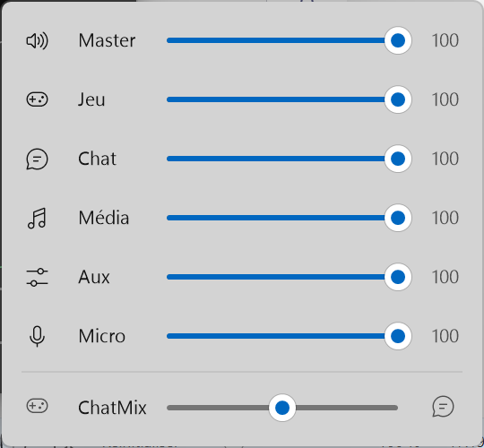

# Sonar Remote

Un mixer **SteelSeries Sonar** dans la barre des tâches de Windows, et une
télécommande web pour le piloter depuis un iPad ou un téléphone.

Un seul exécutable de 8 Mo, sans installation ni dépendance : il trouve le port
(changeant) de Sonar, dessine lui-même son mixer, sert la télécommande et
s'annonce sur le réseau sous `sonar.local`.

| Mixer de bureau | Télécommande web |
|---|---|
|  |  |

## Mixer de bureau

- **Ouvrir / fermer** : clic sur l'icône du tray ou **Ctrl+Alt+S**. Il se ferme
  tout seul dès qu'il perd le focus, ou avec Échap.
- **Régler** : glisser un curseur, molette au-dessus d'une ligne, clic sur
  l'icône d'un canal pour le couper. Master, Jeu, Chat, Média, Aux, Micro et ChatMix.
- **Clavier** : ↑ ↓ pour changer de ligne, ← → pour régler, Espace ou M pour couper.
- **Icône** : cinq barres qui suivent le volume Master, barrées quand il est coupé.
- **Clic droit** : connecter un iPad ou un téléphone, ouvrir la télécommande web,
  lancer au démarrage de Windows, quitter.

Le mixer est une fenêtre Win32 native dessinée en GDI+ : il s'ouvre en un
dixième de seconde, suit le thème clair/sombre et la couleur d'accentuation de
Windows, et ne lance aucun processus navigateur. Au repos, l'application occupe
10 à 15 Mo de mémoire et pratiquement aucun temps processeur.

## Télécommande web

Clic droit sur l'icône du tray → *Connecter un iPad ou un téléphone* : scanne le
QR code depuis un appareil du même réseau. L'adresse est écrite dessous, et
**http://sonar.local** marche aussi. Sur iOS, *Partager → Sur l'écran d'accueil*
en fait une app plein écran.

- Un fader par canal, avec bouton de coupure, et le ChatMix en bas.
- Choix de la sortie audio et du micro depuis la barre du haut.
- Les applications en cours apparaissent sous leur canal : touche-en une pour
  l'envoyer vers un autre.
- L'engrenage choisit ce qui s'affiche (canaux, profils d'égaliseur,
  applications, ChatMix), mémorisé sur chaque appareil.
- Sur un écran étroit, les canaux passent en lignes horizontales.

## Installation

Compile `sonar-remote.exe` (voir plus bas) ou récupère-le dans les
[releases](../../releases), lance-le, puis coche *Lancer au démarrage de
Windows* dans le menu du tray.

Au premier lancement, autorise l'application sur les réseaux **privés** si tu
veux la télécommande web.

```
sonar-remote.exe [options]
  --port     Port de la télécommande web (défaut 80 → http://<host>.local sans port)
  --host     Nom publié en mDNS, <host>.local (défaut "sonar")
  --no-mdns  Ne pas s'annoncer sur le réseau
  --no-tray  Télécommande web seule, sans le mixer de bureau
  --log      Fichier où écrire les journaux et les traces de plantage
```

Les options passées au lancement sont conservées par *Lancer au démarrage*.

## Compiler

Il faut [Go](https://go.dev/dl/) et [Bun](https://bun.sh).

```powershell
./build.ps1          # télécommande web + sonar-remote.exe
go test ./...
```

Pour travailler sur la télécommande avec rechargement à chaud :

```powershell
go run . --port 8080        # terminal 1 : l'application, journaux dans la console
cd web; bun run dev         # terminal 2 : Vite, qui relaie /api vers :8080
```

Pousser un tag `v*` publie une release avec l'exécutable (voir
[`.github/workflows/build.yml`](.github/workflows/build.yml)).

## Fonctionnement

```
                          sonar-remote.exe
tray + raccourci ──▶ mixer natif ──────────┐
                                           ├──▶ Sonar (127.0.0.1, port changeant)
iPad ──http──▶ /       télécommande web    │
               /api/*  relais ─────────────┘
               mDNS    sonar.local
```

| Dossier | Rôle |
|---|---|
| `internal/sonar` | Trouve Sonar et lui parle : `coreProps.json` → `ggEncryptedAddress` → `/subApps` → adresse de l'API. Redécouvre l'adresse et réessaie quand Sonar redémarre. |
| `internal/desktop` | Icône du tray, raccourci global, mixer (Win32 + GDI+, sans CGO). |
| `internal/mdnsx` | Publie `sonar.local`, par Bonjour s'il est installé, sinon par un répondeur intégré. Suit les changements d'adresse IP. |
| `web` | La télécommande : Svelte 5 + Vite, 22 Ko gzip, embarquée dans l'exécutable. |

L'API de Sonar n'est pas documentée par SteelSeries ; ce qui en est utilisé ici
est décrit dans [`openapi.yaml`](openapi.yaml).

## Dépannage

| Symptôme | Piste |
|---|---|
| « Sonar est introuvable » | SteelSeries GG et Sonar doivent tourner. La reconnexion est automatique. |
| `sonar.local` ne répond pas | Même réseau ? Certains Wi-Fi isolent les appareils entre eux : essaie l'adresse IP du PC. |
| La télécommande ne s'ouvre pas, le mixer si | Le port 80 est pris par un autre programme : lance avec `--port 8080`. |
| Rien ne se passe au lancement | Relance avec `--log sonar.log` et regarde le fichier. |

Seul le mode Classic de Sonar est pris en charge : en mode Streamer, les
curseurs règlent toujours le mix Classic.

La télécommande web n'a pas d'authentification : tout appareil du réseau local
peut régler le volume. Si tu ne t'en sers pas, refuse l'accès réseau quand le
pare-feu Windows le demande : le mixer de bureau n'en a pas besoin.
