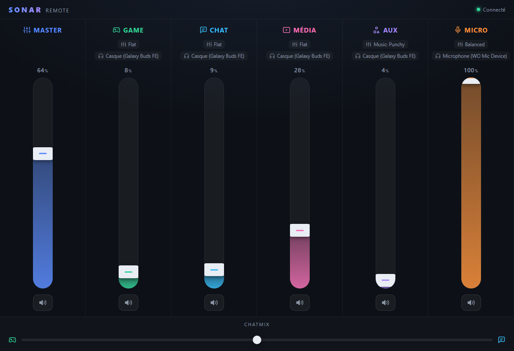

# Sonar Remote

Contrôle **SteelSeries Sonar** à distance depuis ton iPad / téléphone / autre PC,
via une interface web tactile moderne. Un seul petit exécutable tourne sur le PC :
il découvre le port (rotatif) de Sonar, proxifie son API, sert l'interface web, et
s'annonce en **mDNS** sous `sonar.local`.

Et directement sur le PC : un **mixer dans la barre des tâches** (façon EarTrumpet),
avec icône dynamique et raccourci clavier — pratique quand l'iPad n'est pas à portée.



## Fonctionnalités

- 🎚️ Faders verticaux tactiles + boutons mute par canal (Master, Game, Chat, Média, Aux, Micro)
- 🖥️ **Mixer de bureau dans le tray** (Windows) façon EarTrumpet : icône dynamique reflétant le Master, flyout compact, raccourci global **Ctrl+Alt+S** (voir plus bas)
- 🎛️ Balance **ChatMix** (jeu ⇄ chat)
- 🔄 Synchro live (~1 s) : bouger un slider dans l'app Sonar du PC se reflète sur l'iPad, et inversement
- 🏷️ Affiche le preset EQ et le périphérique de sortie de chaque canal
- 🔊 Changer le périphérique de sortie (classic) : tape sur le nom d'appareil d'un canal de rendu → sélecteur des sorties physiques disponibles
- 🎤 Changer le micro (entrée) : tape sur l'appareil du canal Micro → sélecteur des entrées physiques
- 🎚️ Voir les applications routées sur chaque canal et les déplacer d'un canal à l'autre (tape une app → choisis le canal cible)
- ⚙️ Réglages d'affichage (icône engrenage) : choisis ce qui s'affiche — profils EQ, périphériques, applications, ChatMix, et chaque canal individuellement. Idéal pour les petits écrans. Mémorisé sur l'appareil (localStorage)
- 📡 Découverte automatique du port dynamique de Sonar (auto-réparation si Sonar redémarre)
- 🌐 `sonar.local` en mDNS (résolu nativement par iOS/macOS via Bonjour)
- 📦 Binaire Go unique (~11 Mo), interface embarquée, ~10 Mo de RAM au repos (le mixer de bureau ne charge WebView2 qu'à l'ouverture et le libère après 30 s de fermeture)

## Stack

| Couche      | Techno |
|-------------|--------|
| Backend     | Go (net/http reverse-proxy, `grandcat/zeroconf` pour le mDNS, UI embarquée via `embed`) |
| Frontend    | Svelte 5 + Vite + TypeScript (bundle ~19 Ko gzip) |
| Tray (Win)  | Win32 natif (`golang.org/x/sys/windows`) pour l'icône/hotkey, flyout via WebView2 (`jchv/go-webview2`, sans CGO) |

## Démarrage rapide

Prérequis : [Go](https://go.dev/dl/) ≥ 1.22 et [Bun](https://bun.sh) (pour builder l'UI).

```powershell
# 1. Build (UI + binaire)
./build.ps1

# 2. Lancer
./sonar-remote.exe            # http://localhost  et  http://sonar.local
```

Puis sur l'iPad (même réseau Wi-Fi) : ouvre **http://sonar.local**.
Astuce iOS : *Partager → Sur l'écran d'accueil* → tu obtiens une **icône** dédiée
et une app plein écran (nom « Sonar », mode standalone via le web manifest).

## Options

```
./sonar-remote.exe --port 80 --host sonar
  --port     Port HTTP (défaut 80 → http://<host>.local sans port)
  --host     Nom mDNS publié <host>.local (défaut "sonar")
  --no-mdns  Désactive l'annonce mDNS
  --no-tray  Désactive le mixer de bureau (serveur seul, sans icône tray)
```

Si le port 80 est déjà pris (IIS/http.sys), utilise `--port 8080` → `http://sonar.local:8080`.

## Mixer de bureau (barre des tâches)

Sous Windows, en plus du serveur web, l'app pose une **icône dans le tray** et un
petit **flyout** pour piloter tous les canaux sans sortir du jeu :

- **Ouvrir / fermer** : clic gauche sur l'icône, ou le raccourci global **Ctrl+Alt+S**.
- **Icône dynamique** : reflète le volume et le mute du Master (mise à jour toutes les ~5 s).
- **Flyout** : un slider horizontal + mute par canal, plus le ChatMix — se referme
  tout seul quand il perd le focus (comme EarTrumpet).
- **Clic droit** sur l'icône : *Ouvrir dans le navigateur* / *Quitter*.
- **Frugal** : WebView2 (déjà présent sur Windows 11) n'est chargé qu'à la première
  ouverture, et **détruit après 30 s** de fermeture — au repos, l'app tient en ~10 Mo
  sans processus navigateur. Le raccourci utilise le runtime WebView2 *Evergreen*.

Le mixer réutilise le même serveur local : l'accès iPad via `sonar.local` continue
de fonctionner en parallèle. Pour un fonctionnement purement headless, lance avec
`--no-tray`.

> **mDNS** : si Apple Bonjour (`dns-sd`, installé avec iTunes/Bonjour) est présent,
> le serveur enregistre `sonar.local` **via Bonjour** — c'est le résolveur auquel iOS
> fait confiance, et faire tourner un second répondeur mDNS en parallèle crée des
> réponses en conflit (nom résolu mais connexion qui échoue). Sinon, un répondeur
> intégré prend le relais. Dans les deux cas on n'annonce **que ton IP LAN
> principale** (route par défaut) : publier tous les adaptateurs (VPN/WSL/VirtualBox,
> link-local) ferait choisir au client une adresse injoignable → chargement infini.
>
> Le tout premier accès à `sonar.local` peut prendre 1–3 s (propagation mDNS), puis
> c'est instantané (mis en cache). L'IP directe reste toujours dispo en secours.

## Lancer au démarrage de Windows

```powershell
./install-startup.ps1                 # tâche planifiée au logon, tourne en fond
./install-startup.ps1 -Port 80        # variante port 80
./install-startup.ps1 -Remove         # désinstaller
```

La tâche démarre l'app sans fenêtre de console (lanceur `.vbs`) mais **l'icône du
tray reste disponible** : tu peux ouvrir le mixer avec `Ctrl+Alt+S` dès l'ouverture
de session.

## Pare-feu

Au premier lancement, autorise l'app sur les réseaux **privés**. Sinon :

```powershell
New-NetFirewallRule -DisplayName "Sonar Remote" -Direction Inbound `
  -Program "$PWD\sonar-remote.exe" -Action Allow -Profile Private
```

## Architecture

```
iPad  ──http──▶  sonar-remote.exe  ──http──▶  Sonar (127.0.0.1:PORT dynamique)
                 │  /api/*  → reverse-proxy vers Sonar (re-découverte auto)
                 │  /*      → interface Svelte embarquée
                 │  /flyout → variante compacte servie au mixer de bureau
                 ├  mDNS    → publie sonar.local (A + _http._tcp)
                 └  tray    → icône Win32 + flyout WebView2 (localhost, même serveur)
```

Découverte du port Sonar : `C:\ProgramData\SteelSeries\GG\coreProps.json`
→ `ggEncryptedAddress` → `https://.../subApps` (TLS auto-signé)
→ `subApps.sonar.metadata.webServerAddress`.

## Dépannage

| Symptôme | Piste |
|----------|-------|
| UI affiche « Hors ligne » | SteelSeries GG / Sonar doit tourner. `curl http://localhost/healthz` |
| `sonar.local` ne résout pas sur iPad | Même réseau ? Wi-Fi qui isole les clients (AP isolation) ? Essaie l'IP directe affichée au démarrage. |
| Port 80 refusé | http.sys/IIS l'occupe → utilise 8080. |
| `go build` échoue sur l'embed | Build l'UI d'abord (`web/dist` doit exister) — utilise `./build.ps1`. |

## Build automatisé (CI)

Le workflow [`.github/workflows/build.yml`](.github/workflows/build.yml) compile l'UI
(Bun) puis le binaire Windows (Go, cross-compilé depuis Linux, CGO désactivé) à chaque
push / PR. Le `sonar-remote.exe` est disponible en **artifact** de chaque run.

Pour publier une **release** avec le binaire, pousse un tag de version :

```bash
git tag v1.0.0 && git push origin v1.0.0
```

## Développement

```powershell
# Terminal 1 : backend (proxy + API) sur 8080
go run . --port 8080
# Terminal 2 : UI en hot-reload (proxy /api → :8080)
cd web ; bun run dev
```

## API

Le reverse de l'API Sonar utilisé est documenté dans [`openapi.yaml`](openapi.yaml).
Le proxy expose ces routes sous le préfixe `/api` (ex. `PUT /api/volumeSettings/classic/game/Volume/0.5`).
